<div align="center">

# 📡 CampusPulse AI

### Twelve college WhatsApp groups. One feed you can trust.

An agentic AI system that reads all of a student's WhatsApp groups, filters the noise, extracts deadlines and tasks,
catches when an announcement changes, busts rumours with official sources, and answers questions with citations.


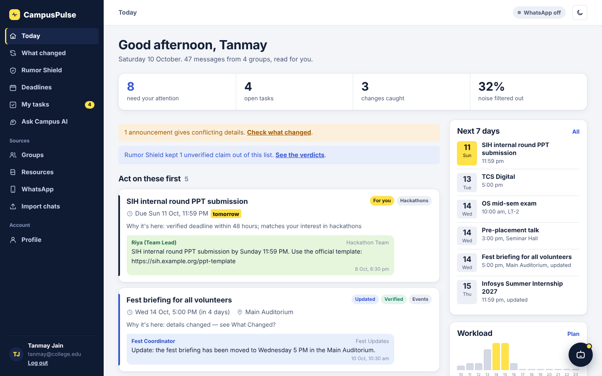

</div>

---

## 📑 Table of contents

1. [The problem](#-the-problem)
2. [The solution](#-the-solution)
3. [Features](#-features)
4. [Screenshots](#%EF%B8%8F-screenshots)
5. [System architecture](#%EF%B8%8F-system-architecture)
6. [The AI pipeline, stage by stage](#-the-ai-pipeline-stage-by-stage)
7. [Rumor Shield, the innovation](#%EF%B8%8F-rumor-shield-the-innovation)
8. [Live WhatsApp integration](#-live-whatsapp-integration)
9. [Ask Campus AI (RAG) and the Pulse chatbot](#-ask-campus-ai-rag-and-the-pulse-chatbot)
10. [Databases](#%EF%B8%8F-databases)
11. [Authentication and security](#-authentication-and-security)
12. [REST API](#-rest-api)
13. [Folder structure](#-folder-structure)
14. [Getting started](#-getting-started)
15. [Testing and evaluation](#-testing-and-evaluation)
16. [Tech stack](#%EF%B8%8F-tech-stack)
17. [Limitations and roadmap](#-limitations-and-roadmap)

---

## 🎯 The problem

A typical engineering student is in a dozen WhatsApp groups: class, section, placement cell, hackathon team, fest
committee, clubs. Important information gets lost:

| Pain point | What actually happens |
|---|---|
| **Noise** | A deadline is buried under 40 messages of "ok", "thanks" and 👍. |
| **Duplicates** | The same internship is forwarded to five groups. |
| **Silent changes** | A venue moves in one group; you only saw the original message in another. |
| **Conflicts** | The CR says Thursday, a classmate says Friday. Who's right? |
| **Rumours** | *"I heard the mid-sem is postponed??"* spreads faster than the professor's correction. |
| **Irrelevance** | Half the announcements are for other years or branches. |
| **Lost doubts** | Someone asks "where's the briefing?" and nobody answers, even though the answer is in another group. |

## 💡 The solution

CampusPulse AI imports a student's groups (by **linking their WhatsApp number** or by **uploading chat exports**)
and runs every message through an agentic pipeline that produces one ranked, personal, trustworthy feed.

> **Core design rule:** the original WhatsApp messages are the source of truth. AI organises and interprets them but
> never silently replaces them. Every card, task and answer links back to the original message: its group, sender
> and time.

---

## ✨ Features

### Core

| Feature | Description |
|---|---|
| 🏠 **Today's Brief** | One ranked feed across every group, scored with an explainable formula. Each card says *why it's here*. |
| 🧹 **Noise filter** | "ok", "thanks", emoji-only, system and deleted messages are marked as noise. They are kept, never deleted. |
| 🏷️ **Classification** | Category (academics, placements, hackathons, events, resources, faculty) and type (deadline, task, update, announcement, question, resource, chatter). |
| 📅 **Smart date extraction** | "Sunday 11:59 PM", "tmrw", "14 October" are resolved against the *message's own timestamp*. Ambiguous dates are flagged. |
| 🔁 **Cross-group de-duplication** | The same announcement in several groups becomes one card: *"also posted in …"*. |
| 🔄 **What Changed? engine** | Detects when a newer message changes an earlier one and shows a field-level diff (old → new). It never assumes "latest wins": unclear cases become **conflicts**. |
| 🙋 **Is this for me?** | Matches year, batch, branch, team and interests: *relevant / not relevant / unknown*. Nothing is hidden silently. |
| ✅ **My Tasks** | Action items are generated automatically. When a deadline is extended in any group, the task's due date moves too. |
| 🗓️ **Deadlines + Crunch Radar** | A 14-day workload forecast that highlights days where deadlines pile up and suggests when to start each task. |
| 📆 **Calendar export** | One click → `.ics` file for Google Calendar, Outlook or Apple Calendar, with 24-hour reminders. |
| 📚 **PDF digests** | Circulars and guidelines are split into page-referenced chunks, summarised and made searchable. |

### Innovation and intelligence

| Feature | Description |
|---|---|
| 🛡️ **Rumor Shield** | Every claim gets a verdict (**Verified / Unverified / Contradicted**) with a 0–100 trust score and evidence from official senders in *any* group. |
| 🔎 **Cross-Group Doubt Solver** | Finds questions nobody answered in their own group and answers them from other groups and documents. |
| 💬 **Ask Campus AI** | Retrieval-augmented answers from your messages and PDFs only, with citations. It says *"I couldn't find this"* instead of inventing. |
| 🤖 **Pulse chatbot** | A floating rule-based assistant (no API key): *"what's due tomorrow?"*, *"any rumours?"*, *"mark SIH done"*. |

### Platform

| Feature | Description |
|---|---|
| 🔐 **User accounts** | Sign up and log in, with hashed passwords, secure sessions, login throttling and CSRF protection. |
| 👤 **Per-user isolation** | Every account has its own database, files and WhatsApp session. |
| 📲 **Live WhatsApp** | Link your number by QR code (like WhatsApp Web), choose the groups, and new messages sync automatically. Your WhatsApp profile photo, name and "about" appear on your profile. |
| 🌗 **Light and dark themes** | A professional two-tone dashboard (navy sidebar, light workspace) and a full dark mode. |
| 📱 **Responsive** | Works on phones with a slide-out menu. |
| 🧠 **Optional LLM** | Runs fully offline on the rule engine. Add an Anthropic or OpenAI-compatible key to refine classification and answers. |

---

## 🖼️ Screenshots

| Login | Dashboard (dark) |
|---|---|
| 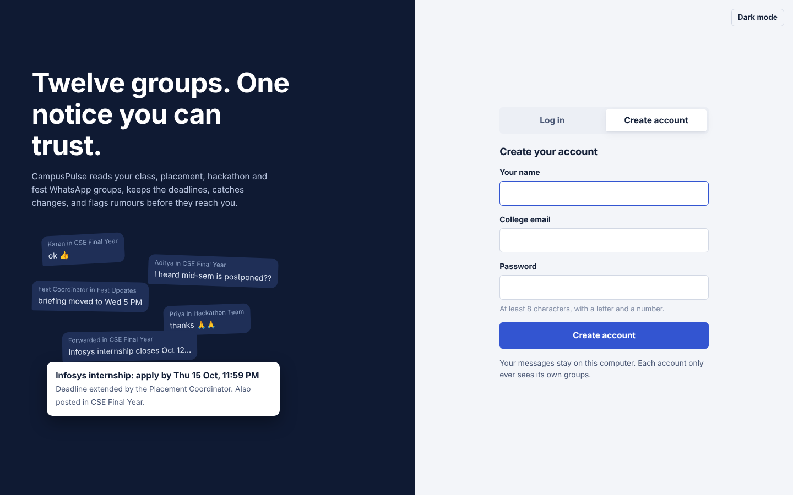 | 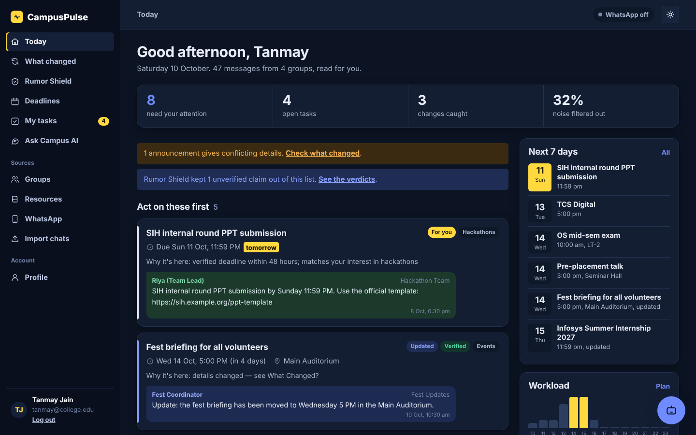 |
| **What Changed?** | **Rumor Shield** |
| 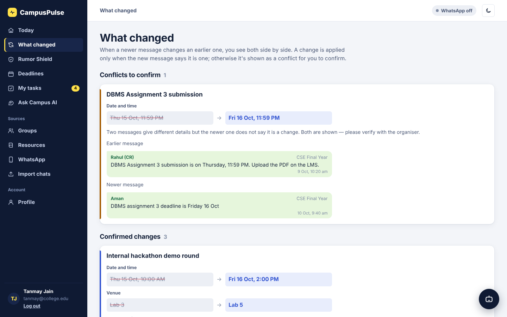 | 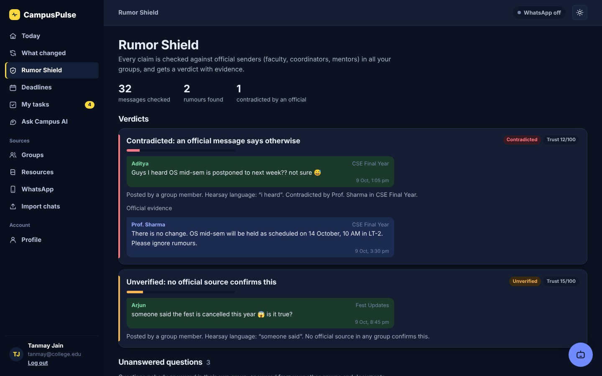 |
| **Pulse chatbot** | **Live WhatsApp** |
| 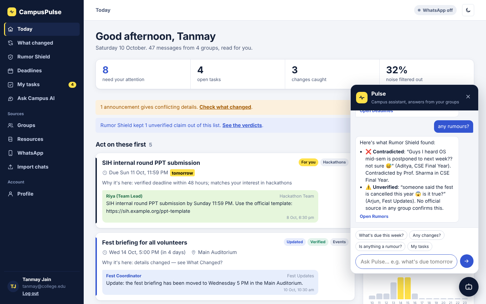 | 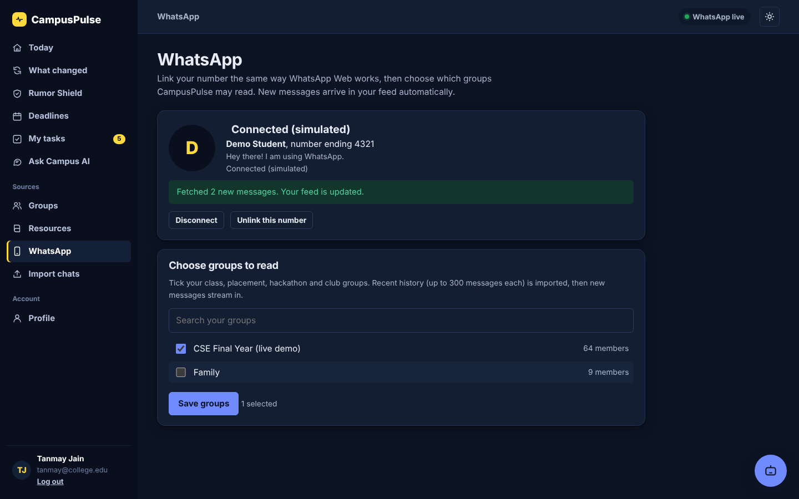 |
| **Deadlines and Crunch Radar** | **Mobile** |
| 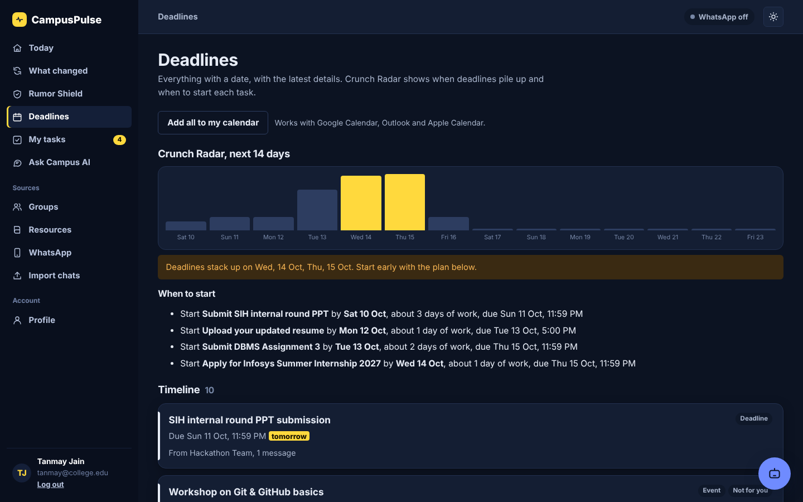 | 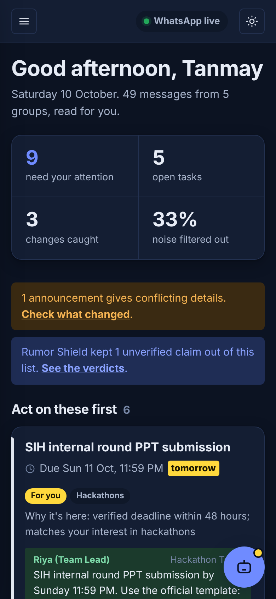 |

---

## 🏗️ System architecture

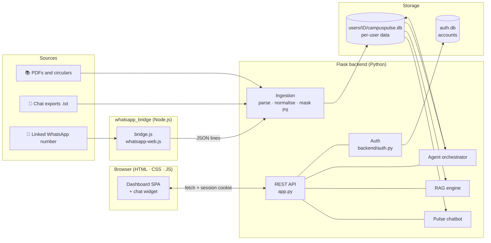

| Layer | Responsibility | Key files |
|---|---|---|
| **Ingestion** | Parse Android/iOS exports and live bridge records, normalise, mask phone numbers, fingerprint | `ingestion/` |
| **Agent pipeline** | Noise filter → classify → extract → trust → dedupe → change detection → personalise → prioritise | `agent/` |
| **Retrieval** | BM25 search over messages and PDF pages, grounded answers with citations | `rag/` |
| **Backend** | Auth, per-user data spaces, WhatsApp bridge manager, REST API, chatbot | `app.py`, `backend/` |
| **Frontend** | Login page and single-page dashboard with hash routing, themes and chat widget | `web/` |
| **Bridge** | Links a WhatsApp number via QR and streams selected groups | `whatsapp_bridge/` |

---

## 🧠 The AI pipeline, stage by stage

The orchestrator (`agent/orchestrator.py`) runs every stage in order. The pipeline is **idempotent**: derived data
(analyses, events, changes) is rebuilt from the raw messages on every run, so re-running never duplicates anything,
while the student's task ticks are preserved.

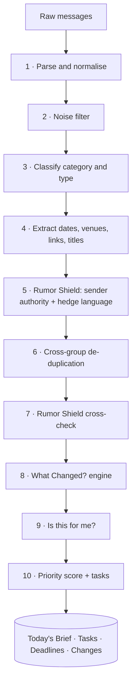

### 1. Parse and normalise (`ingestion/whatsapp_parser.py`, `normalizer.py`)
- Supports **Android** (`10/10/26, 10:42 am - Name: text`) and **iOS** (`[10/10/26, 10:42:15 AM] Name: text`), 12h and 24h clocks, and invisible Unicode characters (narrow no-break spaces, direction marks).
- Lines without a header are joined to the previous message (multi-line messages).
- Classifies raw lines as `text`, `media`, `system` or `deleted`.
- **Day/month disambiguation:** a value above 12 must be the day; otherwise the configured order (`DMY` for India) applies.
- **Privacy:** 10+ digit phone numbers are masked (`••••••3210`) in senders and text.
- **Fingerprint** = `sha1(group | timestamp | sender | text)` for exports, `sha1("wa:" + WhatsApp message id)` for live messages. A unique index means re-importing never duplicates.

### 2. Noise filter (`agent/classifier.py`)
Marks "ok", "thanks", "noted", emoji-only, system and deleted messages as noise. Media is kept (it may be a poster
or PDF). Noise stays visible in the group view behind a toggle; it is never deleted.

### 3. Classification (`agent/classifier.py`)
- **Category:** keyword scoring per category, with the group's own category as a tie-breaker. Messages from faculty that match nothing else are labelled `faculty`.
- **Type:** decision rules in priority order: `update` (change verb + date or venue), then `question`, `deadline` (deadline verb + date), `task`, `resource`, `announcement`, `chatter`.

### 4. Information extraction (`agent/extractor.py`)
- **Dates:** relative (`today`, `tmrw`, `day after tomorrow`), weekdays (`Sunday`, `next Monday`), `12 October`, `Oct 12th`, `12/10`. Relative dates resolve against **the message's timestamp**, not today.
- **Times:** `11:59 PM`, `5pm`, `17:00`, `noon`, `EOD`. Deadlines without a time default to 23:59.
- **Update messages** use the *last* date mentioned ("moved from Tuesday **to Wednesday**").
- **Venues:** `Room 204`, `LT-2`, `Lab 5`, `Main Auditorium`, `venue: …`.
- **Titles:** the main sentence is chosen (skipping "Good morning everyone."), then cut to a short title.
- **Task titles:** "SIH PPT submission" becomes **"Submit SIH PPT"**; "applications close" becomes **"Apply for …"**.

### 5–7. Trust and de-duplication
See [Rumor Shield](#%EF%B8%8F-rumor-shield-the-innovation). De-duplication (`agent/deduplicator.py`) clusters two messages when:

| Rule | Condition |
|---|---|
| Shared link | Same URL **and** overlapping topic |
| Near-identical text | `SequenceMatcher` ratio ≥ 0.85 (after removing "Forwarded") |
| Same event | Same date and time, ≥ 2 shared entity tokens, topic Jaccard ≥ 0.5 |

### 8. The What Changed? engine (`agent/change_detector.py`)
Each meaningful message is matched to an existing **event** by topic:

- **Topic tokens:** words that describe *what* (dates, times, venues, hedges and change verbs removed).
- **Strong tokens:** entity-like words: acronyms (`SIH`, `DBMS`), proper nouns (`Infosys`) and head nouns (`assignment`, `internship`, `briefing`).
- **Match** = ≥ 2 shared strong tokens, **or** 1 shared strong token with topic Jaccard ≥ 0.3.

Then a field-level diff is computed (date/time, venue, cancellation):

| New message is… | Result |
|---|---|
| Same details | Linked as `duplicate` or `corroborates` |
| Different details **and** an explicit update ("moved", "rescheduled", "extended") | **Change applied**: current values updated, original kept, audit log written |
| Different details, **not** an explicit update | **Conflict**: both shown, nothing auto-resolved |
| A question or hearsay | **Never** modifies an event |

Tasks are linked to events, so an extended deadline automatically updates the task.

### 9. Is this for me? (`agent/personalizer.py`)
Extracts eligibility from the text and compares it with the profile:

| Signal | Example | Outcome for a 4th-year, 2027-batch CSE student |
|---|---|---|
| Year | "only for 2nd year students" | ❌ not relevant: *"Meant for 2nd year; you are in year 4"* |
| Batch | "open to 2028 batch" | ❌ not relevant |
| Branch | "CSE/IT/ECE only" | ✅ relevant |
| Team | "Team Aagaz" | ✅ relevant |
| Interests | category = placements | ✅ relevant |
| Nothing stated | — | ❔ unknown |

Not-relevant items stay in a collapsible "Filtered out for your profile" section, with the reason.

### 10. Priority and Today's Brief (`agent/planner.py`)

```
P = 0.35·U + 0.30·D + 0.20·R + 0.15·C        (each factor 0–100)
```

| Factor | Meaning | Scoring |
|---|---|---|
| **U** Urgency | Time to the (current) deadline | ≤24h → 100, ≤48h → 85, ≤72h → 70, ≤7d → 50, later → 20, passed → 0 |
| **D** Importance | Message type | deadline 90, task 80, update 78, announcement 55, resource 40, question 25 |
| **R** Relevance | Personalisation | relevant 100, unknown 60, not relevant 10 |
| **C** Confidence | Extraction confidence | 0–100 |

**Hard rule:** a verified deadline within 48 hours is lifted to ≥ 90. Rumours are capped at 30 and kept out of the
brief. Changed or conflicting events are lifted to ≥ 80. Items are grouped as **Act on these first** (≥ 80),
**Coming up** (55–79) and **For your information**.

**Crunch Radar** spreads each pending task's estimated effort (PPT 3 days, assignment 2, application 1, exam 4…)
across the days before its deadline. Days with a load ≥ 2 are crunch days, and each task gets a **Smart Start** date.

---

## 🛡️ Rumor Shield, the innovation

WhatsApp groups don't only lose information; they spread misinformation. Rumor Shield (`agent/trust_engine.py`)
gives every claim a verdict with evidence.

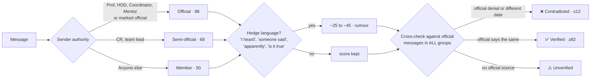

- **Signals:** sender authority, hedge phrases, forwarded markers, cross-group corroboration and explicit denials ("no change", "as scheduled", "ignore rumours").
- "Please ignore rumours" from a professor is recognised as a **denial**, not hearsay.
- Rumours are **kept out of Today's Brief**, can **never change an event**, and the chatbot and Ask Campus AI warn about them.

**Example from the demo data:**

> **Aditya (CSE Final Year):** "Guys I heard OS mid-sem is postponed to next week?? not sure 😅"
> → ❌ **Contradicted (12/100)**, evidence: **Prof. Sharma:** "There is no change. OS mid-sem will be held as scheduled on 14 October…"

**Cross-Group Doubt Solver:** a question with no reply from someone else (sharing a topic word) within the next six
messages counts as unanswered. CampusPulse answers it from other groups and documents. For example, *"Does anyone
know where the fest briefing is?"* in the class group is answered with the venue change posted in the Fest group.

---

## 📲 Live WhatsApp integration

Meta's official WhatsApp Business API can't read groups a personal number is already in. Its Groups API only covers
groups created by a verified business account. CampusPulse therefore links a number the way **WhatsApp Web** does,
using a QR code.

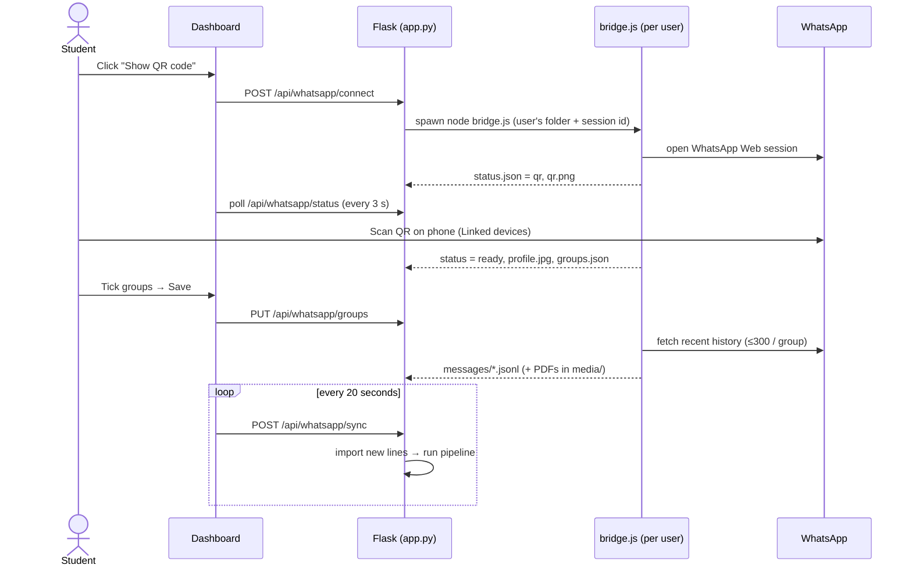

| Property | Details |
|---|---|
| **One bridge per user** | `backend/bridge_manager.py` starts `bridge.js` with that user's folder (`CP_LIVE_DIR`) and session (`CP_SESSION_ID`), so every student links their own number. |
| **Read-only** | The bridge never sends messages and ignores groups that weren't ticked. |
| **File hand-off** | `status.json`, `groups.json`, `selected_groups.json`, `messages/*.jsonl`, `media/*.pdf`, `qr.png`, `profile.jpg`, written atomically. |
| **Profile** | WhatsApp name, masked number, "about" and profile photo are shown on the Profile page. |
| **Control** | Disconnect (keeps the session) or Unlink (logs out) from the dashboard. |
| **Simulator** | `scripts/simulate_bridge.py` fakes the whole flow (QR, connected profile, groups, streamed messages including a change and a rumour) for demos without a phone. |

> ⚠️ Automating WhatsApp Web is unofficial and against WhatsApp's Terms of Service, so the number can be
> restricted. For demos, use a spare number that is a member of the groups.

---

## 💬 Ask Campus AI (RAG) and the Pulse chatbot

### Retrieval-augmented answers (`rag/`)

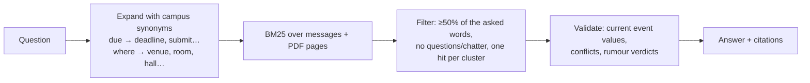

- **BM25** (k1 = 1.4, b = 0.75). Synonyms count at 0.45 weight. Verified sources ×1.25, contradicted ×0.6, plus a gentle recency boost.
- Uses the **current** event values from the change engine ("now Wed 5 PM, Main Auditorium, *changed from* Tue 4 PM, Room 204").
- Surfaces conflicts and warns when a matching message is a busted rumour.
- Citations come from **stored data** (group, sender, time, PDF page), never from generated text.
- With an LLM key, a model writes the answer from the numbered evidence only. Message text is wrapped and treated as untrusted data (prompt-injection safe).

### Pulse chatbot (`backend/chatbot.py`), rule-based with no API key

1. **Normalise** slang: `tmrw → tomorrow`, `plcmnt → placement`, `assgn → assignment`.
2. **Extract entities:** time window (today, tomorrow, this week, next week, a weekday, a date), category and group name.
3. **Detect intent** with ordered regular-expression rules.
4. **Answer** from the student's own data, or fall back to the RAG engine with sources.

| Intent | Try saying |
|---|---|
| Deadlines / schedule | "what's due tmrw?", "placement deadlines", "what's on Wednesday" |
| Changes / conflicts | "any changes?", "any conflicts" |
| Rumours | "any rumours?", "is the fest cancelled?" |
| Tasks | "my tasks", "mark SIH PPT done" (actually ticks it off) |
| Planning | "when should I start?", "am I free tomorrow?" |
| Brief | "summarise today", "what did I miss" |
| Account | "is WhatsApp connected", "who am I", "my groups" |
| Anything else | "where is the fest briefing?" → search with sources |

---

## 🗄️ Databases

CampusPulse uses **SQLite**: one shared accounts database plus **one database per user**. The schema maps directly to
PostgreSQL for a production deployment.

```
data/
├── auth.db                       ← accounts only (no messages)
├── .secret_key                   ← session signing key (auto-generated)
└── users/
    └── <user_id>/
        ├── campuspulse.db        ← that student's messages, analyses, events, tasks
        ├── uploads/              ← PDFs they uploaded
        └── live/                 ← their WhatsApp bridge files
```

### `auth.db`

| Table | Columns | Purpose |
|---|---|---|
| `accounts` | `id`, `name`, `email` (unique, case-insensitive), `password_hash`, `created_at`, `last_login` | Login identities. Passwords are stored only as salted hashes. |

### Per-user `campuspulse.db`

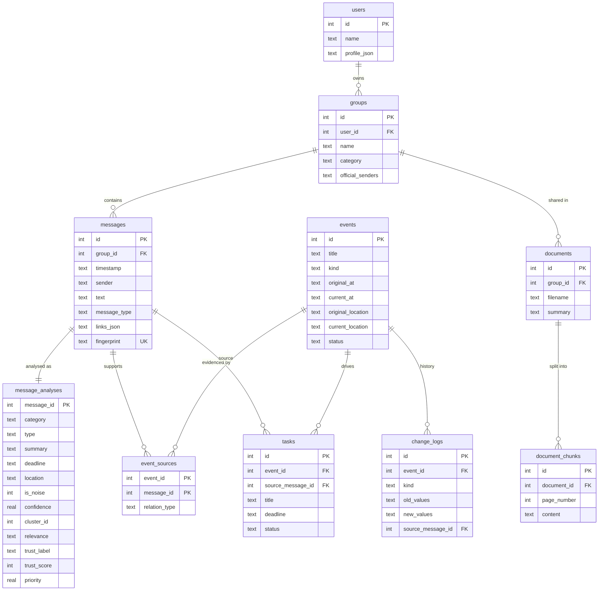

| Table | Purpose |
|---|---|
| `users` | The student profile (name, branch, year, batch, interests, skills, teams, pinned demo date) |
| `groups` | Each WhatsApp group, its category and official senders |
| `messages` | **Raw messages: the source of truth.** Never modified by AI. |
| `message_analyses` | AI output per message: category, type, summary, deadline, venue, noise flag, cluster, relevance, trust verdict, priority |
| `events` | Deadlines and events with **original and current** values and a status (`active`, `changed`, `conflict`, `cancelled`) |
| `event_sources` | Evidence linking events to messages (`origin`, `duplicate`, `corroborates`, `updates`, `conflicts`) |
| `change_logs` | Audit trail of every change and conflict (old values → new values) |
| `tasks` | Action items. Status (`pending` / `done`) survives pipeline re-runs. |
| `documents`, `document_chunks` | Imported PDFs and page-referenced searchable chunks |
| `llm_cache` | Cached, validated LLM responses (only used when a key is configured) |

---

## 🔐 Authentication and security

| Area | Implementation |
|---|---|
| **Passwords** | Salted scrypt / PBKDF2 hashes (`werkzeug.security`); minimum 8 characters with a letter and a number |
| **Sessions** | Signed cookie: `HttpOnly`, `SameSite=Lax`, 7-day lifetime, `Secure` when `COOKIE_SECURE=1`; session id regenerated at login |
| **CSRF** | Every state-changing API call requires a custom `X-Requested-With: CampusPulse` header |
| **Brute force** | 5 failed logins per email and IP → 10-minute lockout; the error never reveals which field was wrong |
| **Isolation** | Separate database, folders and WhatsApp session per account; requests are serialised per user |
| **Input safety** | Upload size and type limits, `secure_filename`, HTML escaping in the frontend, WhatsApp group ids checked against the user's own list |
| **Headers** | `X-Content-Type-Options: nosniff`, `X-Frame-Options: DENY`, `Referrer-Policy: same-origin` |
| **Privacy** | Phone-number masking, data stays on the machine, delete-all-data and delete-account options |
| **Prompt injection** | Message text is treated as data; instructions inside messages are ignored |

---

## 🔌 REST API

All routes return JSON. Routes other than the auth routes require a logged-in session.

| Method | Route | Description |
|---|---|---|
| `POST` | `/api/auth/register` | Create an account and log in |
| `POST` | `/api/auth/login` · `/api/auth/logout` | Log in / out |
| `GET` | `/api/auth/me` | Current user, profile, WhatsApp state |
| `POST` | `/api/auth/password` | Change password |
| `DELETE` | `/api/auth/account` | Delete account and all data |
| `GET` `PUT` | `/api/profile` | Read / update the academic profile (re-ranks the feed) |
| `GET` | `/api/dashboard` | Today's Brief: KPIs, ranked cards, filtered items |
| `GET` | `/api/changes` | Changes and conflicts with both source messages |
| `GET` | `/api/rumors` | Rumour verdicts, evidence and solved doubts |
| `GET` | `/api/deadlines` | Upcoming events, Crunch Radar, Smart Start plan |
| `GET` | `/api/calendar.ics` | Calendar export |
| `GET` · `PATCH` | `/api/tasks` · `/api/tasks/<id>` | List / tick tasks |
| `POST` | `/api/ask` | Ask Campus AI (RAG) |
| `POST` | `/api/chat` | Pulse chatbot |
| `GET` | `/api/groups` · `/api/messages` · `/api/resources` | Groups, filtered messages, PDFs and links |
| `DELETE` | `/api/groups/<id>` · `/api/data` | Delete a group / all imported data |
| `POST` | `/api/import/chat` · `/api/import/pdf` · `/api/import/demo` | Upload exports, a PDF, or load demo data |
| `POST` | `/api/reprocess` | Re-run the pipeline |
| `POST` | `/api/whatsapp/connect` | Start the bridge (`{"simulate": true}` for the simulator) |
| `GET` | `/api/whatsapp/status` · `/qr` · `/avatar` | Connection state, QR image, profile photo |
| `PUT` | `/api/whatsapp/groups` | Choose groups to read |
| `POST` | `/api/whatsapp/sync` · `/disconnect` | Pull new messages / disconnect or unlink |

---

## 📁 Folder structure

```
CampusPulse-AI/
│
├── app.py                      # Flask backend: auth + REST API, serves the web frontend
├── config.py                   # Settings loaded from .env (paths, LLM, weights, defaults)
├── streamlit_app.py            # Earlier single-user Streamlit dashboard (optional)
├── requirements.txt
├── .env.example                # Copy to .env (all values optional)
├── .gitignore
│
├── web/                        # ── Frontend (HTML · CSS · JavaScript) ──
│   ├── index.html              # Login / create account
│   ├── app.html                # Dashboard shell: sidebar, header, chat widget, icons
│   ├── css/style.css           # Two-tone design system, light + dark themes, responsive
│   └── js/
│       ├── api.js              # fetch wrapper (CSRF header, errors) + HTML escaping
│       ├── auth.js             # Login / sign-up form, theme toggle
│       ├── app.js              # SPA router and every page (Today, Changes, Rumors, …)
│       └── chatbot.js          # Pulse chat widget
│
├── backend/                    # ── Web backend services ──
│   ├── auth.py                 # Accounts, password hashing, login throttling
│   ├── userspace.py            # Per-user database, folders, "today" for demos
│   ├── bridge_manager.py       # Starts/stops one WhatsApp bridge per user
│   └── chatbot.py              # Rule-based chatbot: intents + entity extraction
│
├── agent/                      # ── The AI pipeline ──
│   ├── orchestrator.py         # Runs every stage in order
│   ├── classifier.py           # Noise filter, category, message type
│   ├── extractor.py            # Dates, times, venues, links, titles, task names
│   ├── trust_engine.py         # Rumor Shield + unanswered-question detection
│   ├── deduplicator.py         # Cross-group duplicate clusters
│   ├── change_detector.py      # What Changed? engine: events, diffs, conflicts
│   ├── personalizer.py         # Is this for me? (year, batch, branch, team)
│   ├── planner.py              # Priority formula, Today's Brief, Crunch Radar
│   ├── textutils.py            # Tokenising, topic signatures, keyword lists
│   └── llm.py                  # Optional LLM (Anthropic / OpenAI-compatible)
│
├── ingestion/                  # ── Getting data in ──
│   ├── whatsapp_parser.py      # Android + iOS chat export parser
│   ├── normalizer.py           # Normalised records, phone masking, fingerprints
│   ├── upload.py               # Upload validation + import
│   ├── pdf_parser.py           # PDF text, chunks and key points with page numbers
│   └── live_sync.py            # Imports messages streamed by the WhatsApp bridge
│
├── rag/                        # ── Ask Campus AI ──
│   ├── retrieval.py            # BM25 search with campus synonyms
│   ├── answer.py               # Grounded answers + Cross-Group Doubt Solver
│   └── citations.py            # Source labels from stored data
│
├── database/                   # ── Storage ──
│   ├── models.py               # SQL schema
│   ├── schemas.py              # Pydantic models (validated contracts)
│   ├── connection.py           # SQLite connection + initialisation
│   └── repository.py           # All database reads and writes
│
├── whatsapp_bridge/            # ── Live WhatsApp (Node.js) ──
│   ├── bridge.js               # QR login, group list, history, live messages, profile
│   └── package.json
│
├── utils/calendar_export.py    # .ics calendar generation
├── api/main.py                 # Alternative FastAPI service (optional)
├── frontend/                   # Pages for the Streamlit version (optional)
│
├── scripts/
│   ├── seed_demo.py            # Load demo groups + PDF from the command line
│   ├── simulate_bridge.py      # Fake WhatsApp bridge for demos
│   └── make_sample_pdf.py      # Generates the sample SIH guidelines PDF
│
├── tests/                      # 45 tests (pytest)
│   ├── test_parser.py          # Export formats, multi-line, masking, duplicates
│   ├── test_extraction.py      # Dates, venues, noise, categories, personalisation
│   ├── test_changes.py         # Changes, conflicts, clusters, rumours, idempotency
│   ├── test_retrieval.py       # Answers, PDF citations, doubts, prompt injection
│   ├── test_trust.py           # Sender authority and hedge scoring
│   ├── test_live_sync.py       # WhatsApp bridge import
│   ├── test_web_api.py         # Auth, CSRF, hashing, user isolation
│   └── test_chatbot.py         # Chatbot intents and entities
│
├── data/
│   ├── sample_chats/           # 4 synthetic group exports (demo)
│   ├── sample_docs/            # Synthetic SIH guidelines PDF
│   ├── uploads/
│   └── users/                  # Created at runtime, one folder per account (git-ignored)
│
└── docs/screenshots/           # Images used in this README
```

---

## 🚀 Getting started

### Prerequisites
- **Python 3.9+**
- **Node.js 18+** (only for linking a real WhatsApp number)

### 1. Clone and install

```bash
git clone https://github.com/<your-username>/CampusPulse-AI.git
cd CampusPulse-AI

python -m venv .venv
.venv\Scripts\activate            # Windows
# source .venv/bin/activate       # macOS / Linux

pip install -r requirements.txt
```

### 2. Run

```bash
python app.py
```

Open **http://127.0.0.1:5000**, create an account, and click **Load demo data**.

### 3. (Optional) Link a real WhatsApp number

```bash
cd whatsapp_bridge
npm install          # one time; also downloads a headless Chrome
cd ..
python app.py
```

In the app go to **WhatsApp → Show QR code**, then on your phone open **Settings → Linked devices → Link a device**
and scan the code. Tick the groups to read and click **Save groups**.

No phone? Click **Try a simulated connection**.

### 4. (Optional) Configuration

Copy `.env.example` to `.env`. Everything is optional:

| Variable | Purpose |
|---|---|
| `LLM_PROVIDER`, `ANTHROPIC_API_KEY` / `OPENAI_API_KEY`, `LLM_MODEL`, `OPENAI_BASE_URL` | Optional LLM refinement |
| `FLASK_SECRET_KEY` | Session signing key (auto-generated if empty) |
| `COOKIE_SECURE=1` | Use when serving over HTTPS |
| `WHATSAPP_DATE_ORDER` | `DMY` (India/UK, default) or `MDY` (US) exports |
| `MAX_UPLOAD_MB` | Upload size limit (default 10) |
| `PORT`, `HOST` | Server address (default `127.0.0.1:5000`) |

> **Demo date:** the sample chats are dated 5–10 Oct 2026. Loading the demo pins "today" to 10 Oct 2026 for that
> account so the deadlines are upcoming. Change or remove it under **Profile → Pin "today" to a fixed date**.

### 🎬 Two-minute demo script

1. **Load demo data:** 47 messages from 4 groups, about 32% noise filtered. The SIH PPT deadline is on top, highlighted *tomorrow*.
2. **Infosys internship:** one card *"also in CSE Final Year"*, showing the **extended** deadline.
3. **What changed:** fest briefing *Tue 4 PM, Room 204 → Wed 5 PM, Main Auditorium*; the DBMS deadline **conflict** is shown, not auto-resolved.
4. **Rumor Shield:** the mid-sem "postponed" rumour is **Contradicted** by Prof. Sharma; an unanswered question is solved from another group.
5. **Pulse chatbot:** *"what's due this week?"*, *"any rumours?"*, *"mark sih ppt done"*.
6. **Profile:** switch to year 3 / 2028 batch, and the 3rd-year Amazon drive moves into the feed.
7. **WhatsApp:** *Try a simulated connection*, tick the group, and watch new messages, a change and a busted rumour arrive live.
8. **Dark mode:** the sun/moon button in the header.

---

## 🧪 Testing and evaluation

```bash
pytest -q
```

45 tests cover the evaluation cases from the design:

| Test case | Expected result |
|---|---|
| "ok, thanks" | Marked as noise, not in the brief |
| Same internship in two groups | One cluster, both sources kept |
| "Sunday 11:59 PM" in a Thursday message | Resolved to that Sunday 23:59 |
| Venue changes | Old and new values linked in the change history |
| Two deadlines disagree | Conflict shown; the newer message does not silently win |
| Hearsay "I heard … postponed" | Never changes the event; marked Contradicted by the official denial |
| SIH team-size question | Answer cites PDF page 2 |
| Announcement for another year | Labelled *not for you*, with the reason |
| Duplicate export uploaded | No messages imported twice |
| Prompt injection inside a message | Treated as data, not prioritised |
| Second user account | Sees none of the first user's data |
| Deadline extended | Linked task's due date updates; ticked tasks stay ticked |

---

## 🛠️ Tech stack

| Layer | Technology |
|---|---|
| Backend | Python, Flask, Werkzeug (password hashing), Pydantic |
| AI pipeline | Rule-based NLP (regex, token signatures, Jaccard, `difflib`), BM25 retrieval; optional Anthropic / OpenAI-compatible LLM |
| Database | SQLite (PostgreSQL-ready schema) |
| PDFs | pypdf |
| Frontend | Vanilla HTML, CSS (custom properties, light/dark themes) and JavaScript (hash-routed SPA) |
| Live WhatsApp | Node.js, whatsapp-web.js, qrcode |
| Testing | pytest, Flask test client, Playwright (UI checks) |
| Optional | Streamlit dashboard, FastAPI service |

---

## 🧭 Limitations and roadmap

**Current limitations**
- Live sync uses an unofficial WhatsApp Web connection (see the warning above).
- Rule-based extraction covers common English / Hinglish patterns; very messy messages benefit from the optional LLM.
- Images and voice notes are recorded as media, not read.

**Roadmap**
- [ ] Official WhatsApp Business Platform bot for institute-created groups
- [ ] Poster OCR and voice-note transcription
- [ ] Embedding search for paraphrased questions
- [ ] Push / email reminders before deadlines
- [ ] PostgreSQL and multi-device deployment
- [ ] Hindi and regional-language support

---

<div align="center">

**Built to give students back the hour a day they spend scrolling through groups.**

*All demo data is synthetic. Only import chats you are authorised to process.*

</div>
